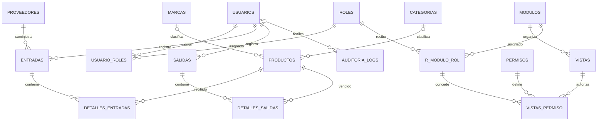
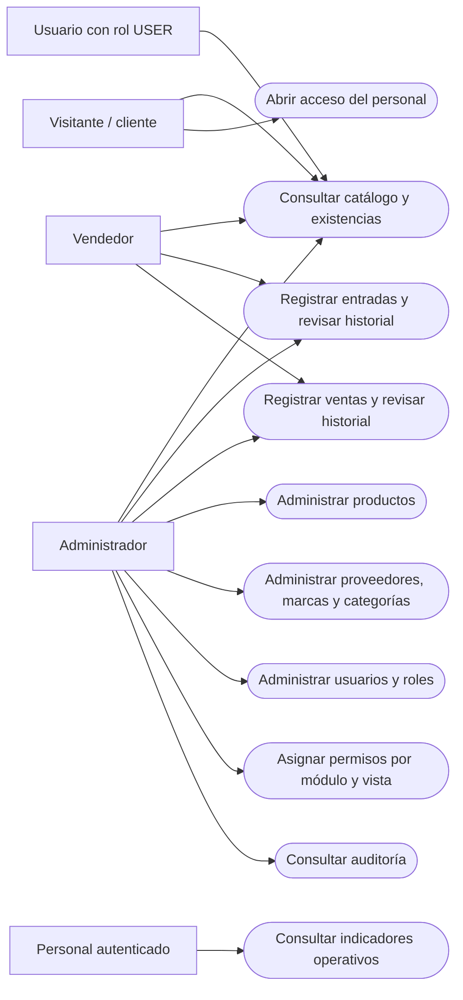
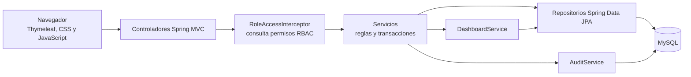
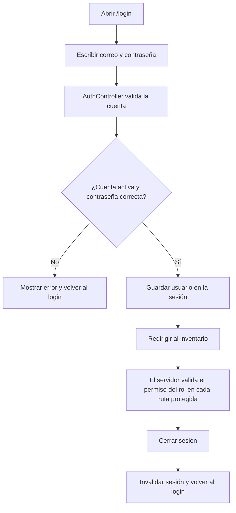

# Instructivo general del proyecto SAFARI

**SAFARI** es una aplicación web para administrar productos y existencias. Permite
consultar el inventario, registrar entradas y ventas, organizar catálogos y
controlar el acceso según el rol del usuario.

## 1. Cómo se realizó el proyecto

1. **Se identificó el proceso del negocio:** mantener un catálogo de productos,
   registrar quién recibe o vende mercancía y actualizar las existencias.
2. **Se diseñó la base relacional:** se separaron los datos en tablas y se
   conectaron mediante claves primarias y foráneas. Las relaciones de muchos a
   muchos usan tablas de detalle o de asociación.
3. **Se implementó la aplicación:** Java 17 y Spring Boot organizan la lógica;
   Spring Data JPA/Hibernate conecta los objetos Java con MySQL.
4. **Se construyeron las pantallas:** Thymeleaf genera las páginas, CSS define
   su presentación y un script JavaScript pequeño controla el indicador de
   carga y la transición al cerrar sesión. Tabler se usa como base visual local.
5. **Se agregaron controles de acceso y movimientos seguros:** los permisos por
   rol, módulo, vista y acción se validan en el servidor; las entradas/ventas
   actualizan el movimiento, el stock y la auditoría dentro de transacciones.
6. **Se verificaron las funciones:** las pruebas automatizadas usan H2 en
   memoria y comprueban pantallas, asignación/revocación de permisos,
   denegaciones, catálogos y movimientos.

### Herramientas y motivo de uso

| Herramienta | Uso en SAFARI |
| --- | --- |
| Java 17 | Lenguaje y entorno de ejecución del servidor. |
| Spring Boot | Estructura la aplicación web y permite ejecutarla con Tomcat integrado. |
| Spring Data JPA / Hibernate | Acceso a datos mediante entidades y repositorios, sin concatenar SQL recibido del usuario. |
| MySQL / XAMPP | Almacenamiento relacional para la instalación local. |
| Thymeleaf | Construcción de páginas HTML con datos enviados por el servidor. |
| CSS y Tabler local | Diseño adaptable y componentes visuales sin depender de una conexión externa. |
| JavaScript | Mostrar el spinner de carga y el mensaje de cierre de sesión. |
| Maven | Compilar, empaquetar la aplicación y ejecutar pruebas. |

## 2. Diagrama entidad-relación

El esquema completo tiene 17 tablas. Las tablas `detalles_entradas` y
`detalles_salidas` relacionan movimientos y productos; `usuario_roles` permite
asignar varios roles a cada usuario. El grupo RBAC y la auditoría añaden seis
tablas al modelo original.



**Cómo leerlo:** `||` representa uno; `o{` representa cero o muchos. Por
ejemplo, una entrada pertenece a un proveedor y puede tener varias líneas de
detalle. Cada línea guarda el producto, cantidad y costo de compra.

### Normalización del esquema

- **Primera forma normal (1FN):** cada columna guarda un valor por fila. Los
  productos de una entrada o venta se guardan en filas independientes de
  `detalles_entradas` y `detalles_salidas`, no como listas dentro del
  encabezado.
- **Segunda forma normal (2FN):** las tablas de asociación `usuario_roles`,
  `r_modulo_rol` y `vistas_permiso` identifican las relaciones mediante claves
  únicas; sus atributos dependen de la relación completa. Los datos de producto,
  rol, módulo, vista y permiso permanecen en sus tablas propias.
- **Tercera forma normal (3FN):** los nombres de categorías, marcas, roles y
  proveedores no se repiten como atributos de cada producto o movimiento; las
  claves foráneas mantienen esas relaciones y reducen dependencias transitivas.

`productos.stock_actual` y `salidas.monto_total` son valores agregados que el
sistema mantiene para consultar rápidamente. No se presentan como datos
normalizados independientes: los movimientos y su detalle son la evidencia
operativa, y el servicio mantiene el stock, el total y su auditoría dentro de
una transacción.

## 3. Diagrama de uso



La aplicación permite consultar el catálogo públicamente. El administrador
gestiona la información, las cuentas y los permisos; el vendedor opera las
entradas y ventas. El personal autenticado ve indicadores operativos. Las rutas
se validan en el servidor, no solo se ocultan botones.

## 4. Diagrama general de la aplicación



Los controladores reciben las acciones de las pantallas. El interceptor protege
las rutas según los permisos asociados al rol; los servicios aplican las reglas
del negocio, guardan eventos de auditoría y calculan indicadores para la página
principal.

## 5. Diagrama físico-relacional (ERAF)

El PDF proporcionado no define el acrónimo **ERAF**. Para este instructivo se
usa como referencia al esquema físico de tablas, claves y relaciones. El
diagrama entidad-relación anterior muestra ese esquema de SAFARI. Sus nombres
reales de columnas usan el formato `id_usuario`, `id_producto`, etc.

Tablas principales:

| Tabla | Información que almacena |
| --- | --- |
| `productos` | Código, nombre, precios y stock. Puede asociarse con una marca y categoría. |
| `categorias`, `marcas` | Clasificación de productos. |
| `proveedores` | Datos de los proveedores de mercancía. |
| `entradas`, `detalles_entradas` | Encabezado de recepción y sus productos/cantidades/costos. |
| `salidas`, `detalles_salidas` | Encabezado de venta y sus productos/cantidades/precios. |
| `usuarios`, `roles`, `usuario_roles` | Cuentas, roles y asignaciones de roles. |
| `modulos`, `vistas`, `permisos` | Catálogo de módulos, pantallas y acciones del RBAC. |
| `r_modulo_rol`, `vistas_permiso` | Asignaciones de módulos y acciones a cada rol. |
| `auditoria_logs` | Acciones importantes, fecha/hora y usuario cuando está autenticado. |

## 6. Diagrama del inicio de sesión



Las contraseñas nuevas se almacenan con BCrypt. El acceso está condicionado a
que la cuenta esté activa; el cierre de sesión invalida la sesión del servidor.

## 7. Uso básico de la aplicación

1. **Iniciar sesión:** abrir `/login` e ingresar las credenciales asignadas.
2. **Consultar inventario:** revisar productos, precios y stock en la página
   principal.
3. **Administrar catálogos (ADMIN):** abrir Catálogos y seleccionar
   Proveedores, Marcas o Categorías. Se puede añadir, editar o eliminar
   registros que no estén en uso.
4. **Administrar productos (ADMIN):** usar el formulario para registrar o
   editar productos y luego consultar el listado.
5. **Registrar una entrada (ADMIN/VENDEDOR):** elegir proveedor, producto,
   cantidad y costo. Al guardar, SAFARI incrementa el stock.
6. **Registrar una venta (ADMIN/VENDEDOR):** buscar un producto por nombre o
   código, elegirlo, indicar la cantidad y presionar Enter para añadirlo a la
   lista. Repetir con cada producto necesario. SAFARI muestra los subtotales y
   el total usando el precio actual,
   valida el stock de todos los productos y confirma todo como una sola venta.
   Al confirmar, abre un comprobante interno con número, fecha, detalle, precios
   y total que se puede imprimir desde el navegador. No es una factura fiscal.
7. **Administrar usuarios y roles (ADMIN):** crear cuentas, activar o
   desactivar usuarios y asignar roles. Si se cambia una contraseña, se pide
   confirmar la contraseña actual.
8. **Configurar permisos (ADMIN):** abrir **Roles → Configurar permisos**,
   seleccionar un rol y marcar qué acciones puede realizar en cada vista.
   `ADMIN` conserva sus permisos completos protegidos.
9. **Revisar auditoría (ADMIN):** abrir **Usuarios y roles → Auditoría** para
   consultar los eventos recientes. Los intentos fallidos no guardan el correo
   ni la contraseña ingresados.
10. **Ver indicadores:** el tablero muestra el estado del stock y compara
    entradas y ventas del mes; las cifras operativas requieren iniciar sesión.
11. **Cerrar sesión:** seleccionar “Cerrar sesión”. Se muestra el indicador
   “Cerrando sesión…” y luego aparece la pantalla de acceso.

### Cuentas de demostración

| Rol | Correo | Contraseña |
| --- | --- | --- |
| Administrador | `admin@safari.com` | `admin123` |
| Vendedor | `vendedor@safari.com` | `vendedor123` |
| Usuario de consulta | `usuario@safari.com` | `user123` |

Estas cuentas se crean para demostración si no existen. Cambia sus contraseñas
antes de usar información real.

## 8. Iniciar SAFARI en Windows

1. Iniciar MySQL desde XAMPP.
2. En phpMyAdmin, importar `safari.sql` para crear la base y sus tablas. Si ya
   existe una base con datos, respaldarla y seguir la migración indicada en
   `README.md`; no volver a importar el esquema encima.
3. Desde la carpeta del proyecto, crear el JAR:

   ```powershell
   .\apache-maven-3.9.9\bin\mvn.cmd clean package
   ```

4. Ejecutar el JAR generado:

   ```powershell
   java -jar target\safari-1.0.0.jar
   ```

5. Abrir `http://localhost:8096`. Para detener el servidor, volver a la
   terminal y pulsar `Ctrl+C`.

La base de datos debe estar disponible mientras la aplicación se ejecuta. Para
ejecutar las pruebas automatizadas (usan H2 en memoria y no necesitan XAMPP):

```powershell
.\apache-maven-3.9.9\bin\mvn.cmd test
```

## 9. Alcance frente a la guía académica

SAFARI implementa un RBAC jerárquico con módulos, vistas, permisos de
`CONSULTAR`/`CREAR`/`EDITAR`/`ELIMINAR` y una matriz configurable por rol. También
incluye un registro de auditoría para autenticaciones, accesos denegados,
movimientos, cambios de permisos y operaciones CRUD; y un tablero con
indicadores numéricos y barras gráficas de stock y actividad mensual.

La consistencia de movimientos se prueba con H2: una venta que excede el stock
se rechaza; una prueba adicional fuerza un fallo de auditoría después de guardar
el encabezado y detalle de una venta y comprueba que la transacción revierte
ambos registros y el cambio de stock. La sección de normalización explica las
formas normales y señala los valores agregados que SAFARI mantiene por razones
operativas.

La comprobación aquí descrita corresponde a las tablas, rutas y pruebas de este
repositorio. La migración sobre una base MySQL existente no se ejecutó en una
instalación real durante esta entrega; debe respaldarse la base antes de
aplicarla.
