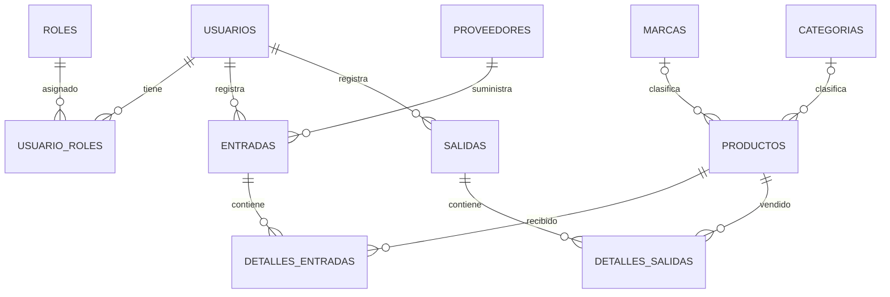
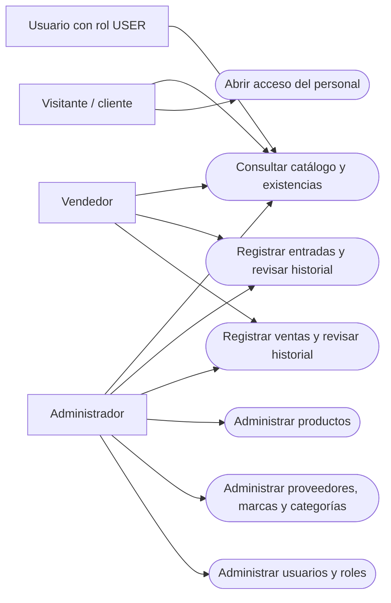
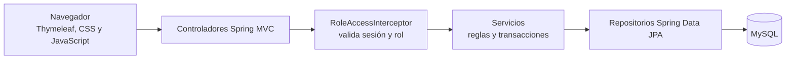
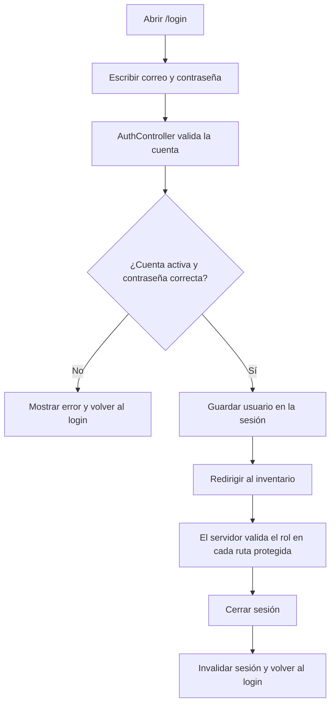

# Instructivo general del proyecto SAFARI

**SAFARI** es una aplicación web para administrar productos y existencias. Permite
consultar el inventario, registrar entradas y ventas, organizar catálogos y
controlar el acceso según el rol del usuario.

## 1. Cómo se realizó el proyecto

1. **Se identificó el proceso del negocio:** mantener un catálogo de productos,
   registrar quién recibe o vende mercancía y actualizar las existencias.
2. **Se diseñó la base relacional:** se separaron los datos en tablas y se
   conectaron mediante claves primarias y foráneas. Las relaciones de muchos a
   muchos usan tablas de detalle o de asociación.
3. **Se implementó la aplicación:** Java 17 y Spring Boot organizan la lógica;
   Spring Data JPA/Hibernate conecta los objetos Java con MySQL.
4. **Se construyeron las pantallas:** Thymeleaf genera las páginas, CSS define
   su presentación y un script JavaScript pequeño controla el indicador de
   carga y la transición al cerrar sesión. Tabler se usa como base visual local.
5. **Se agregaron controles de acceso y movimientos seguros:** los permisos se
   validan en el servidor y las entradas/ventas actualizan el movimiento y el
   stock dentro de transacciones.
6. **Se verificaron las funciones:** las pruebas automatizadas usan H2 en
   memoria y comprueban pantallas, permisos, catálogos y movimientos.

### Herramientas y motivo de uso

| Herramienta | Uso en SAFARI |
| --- | --- |
| Java 17 | Lenguaje y entorno de ejecución del servidor. |
| Spring Boot | Estructura la aplicación web y permite ejecutarla con Tomcat integrado. |
| Spring Data JPA / Hibernate | Acceso a datos mediante entidades y repositorios, sin concatenar SQL recibido del usuario. |
| MySQL / XAMPP | Almacenamiento relacional para la instalación local. |
| Thymeleaf | Construcción de páginas HTML con datos enviados por el servidor. |
| CSS y Tabler local | Diseño adaptable y componentes visuales sin depender de una conexión externa. |
| JavaScript | Mostrar el spinner de carga y el mensaje de cierre de sesión. |
| Maven | Compilar, empaquetar la aplicación y ejecutar pruebas. |

## 2. Diagrama entidad-relación

El modelo tiene 11 tablas. Las tablas `detalles_entradas` y `detalles_salidas`
resuelven la relación entre movimientos y productos; `usuario_roles` permite
asignar varios roles a cada usuario.



**Cómo leerlo:** `||` representa uno; `o{` representa cero o muchos. Por
ejemplo, una entrada pertenece a un proveedor y puede tener varias líneas de
detalle. Cada línea guarda el producto, cantidad y costo de compra.

## 3. Diagrama de uso



La aplicación permite consultar el catálogo públicamente. El administrador
gestiona la información y los usuarios; el vendedor opera las entradas y
ventas. Las rutas también se validan en el servidor, no solo se ocultan botones.

## 4. Diagrama general de la aplicación



Los controladores reciben las acciones de las pantallas. El interceptor protege
las rutas según la sesión y el rol; los servicios aplican las reglas del
negocio y los repositorios persisten la información.

## 5. Diagrama físico-relacional (ERAF)

El PDF proporcionado no define el acrónimo **ERAF**. Para este instructivo se
usa como referencia al esquema físico de tablas, claves y relaciones. El
diagrama entidad-relación anterior muestra ese esquema de SAFARI. Sus nombres
reales de columnas usan el formato `id_usuario`, `id_producto`, etc.

Tablas principales:

| Tabla | Información que almacena |
| --- | --- |
| `productos` | Código, nombre, precios y stock. Puede asociarse con una marca y categoría. |
| `categorias`, `marcas` | Clasificación de productos. |
| `proveedores` | Datos de los proveedores de mercancía. |
| `entradas`, `detalles_entradas` | Encabezado de recepción y sus productos/cantidades/costos. |
| `salidas`, `detalles_salidas` | Encabezado de venta y sus productos/cantidades/precios. |
| `usuarios`, `roles`, `usuario_roles` | Cuentas, roles y asignaciones de roles. |

## 6. Diagrama del inicio de sesión



Las contraseñas nuevas se almacenan con BCrypt. El acceso está condicionado a
que la cuenta esté activa; el cierre de sesión invalida la sesión del servidor.

## 7. Uso básico de la aplicación

1. **Iniciar sesión:** abrir `/login` e ingresar las credenciales asignadas.
2. **Consultar inventario:** revisar productos, precios y stock en la página
   principal.
3. **Administrar catálogos (ADMIN):** abrir Catálogos y seleccionar
   Proveedores, Marcas o Categorías. Se puede añadir, editar o eliminar
   registros que no estén en uso.
4. **Administrar productos (ADMIN):** usar el formulario para registrar o
   editar productos y luego consultar el listado.
5. **Registrar una entrada (ADMIN/VENDEDOR):** elegir proveedor, producto,
   cantidad y costo. Al guardar, SAFARI incrementa el stock.
6. **Registrar una venta (ADMIN/VENDEDOR):** elegir producto y cantidad. El
   sistema calcula el total con el precio actual, valida las existencias y
   descuenta el stock.
7. **Administrar usuarios y roles (ADMIN):** crear cuentas, activar o
   desactivar usuarios y asignar roles. Si se cambia una contraseña, se pide
   confirmar la contraseña actual.
8. **Cerrar sesión:** seleccionar “Cerrar sesión”. Se muestra el indicador
   “Cerrando sesión…” y luego aparece la pantalla de acceso.

### Cuentas de demostración

| Rol | Correo | Contraseña |
| --- | --- | --- |
| Administrador | `admin@safari.com` | `admin123` |
| Vendedor | `vendedor@safari.com` | `vendedor123` |
| Usuario de consulta | `usuario@safari.com` | `user123` |

Estas cuentas se crean para demostración si no existen. Cambia sus contraseñas
antes de usar información real.

## 8. Iniciar SAFARI en Windows

1. Iniciar MySQL desde XAMPP.
2. En phpMyAdmin, importar `safari.sql` para crear la base y sus tablas. Si ya
   existe una base con datos, respaldarla y seguir la migración indicada en
   `README.md`; no volver a importar el esquema encima.
3. Desde la carpeta del proyecto, crear el JAR:

   ```powershell
   .\apache-maven-3.9.9\bin\mvn.cmd clean package
   ```

4. Ejecutar el JAR generado:

   ```powershell
   java -jar target\safari-1.0.0.jar
   ```

5. Abrir `http://localhost:8096`. Para detener el servidor, volver a la
   terminal y pulsar `Ctrl+C`.

La base de datos debe estar disponible mientras la aplicación se ejecuta. Para
ejecutar las pruebas automatizadas (usan H2 en memoria y no necesitan XAMPP):

```powershell
.\apache-maven-3.9.9\bin\mvn.cmd test
```

## 9. Alcance frente a la guía académica

SAFARI tiene roles `ADMIN`, `VENDEDOR` y `USER`, una relación muchos a muchos
entre usuarios y roles, validación de rutas en el backend y transacciones para
registrar movimientos y actualizar stock. Las consultas de Spring Data JPA
usan parámetros, en vez de concatenar los datos ingresados.

**No se debe afirmar que SAFARI implementa todo el RBAC jerárquico solicitado
en el PDF:** actualmente no hay tablas de módulos, vistas, permisos granulares
ni auditoría. Tampoco hay un dashboard analítico con indicadores gráficos; la
pantalla principal presenta el inventario y datos resumidos. La guía académica
también pide demostrar formalmente la normalización y pruebas específicas de
auditoría y reversión; el instructivo describe lo que el proyecto tiene, no
declara cumplidas esas partes que aún no están implementadas o documentadas.
