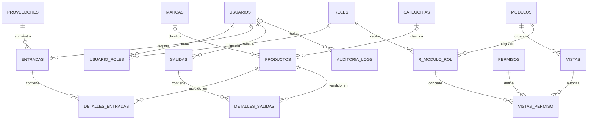

# SAFARI

Aplicación Java Spring Boot para gestionar productos, categorías, marcas, usuarios, proveedores, entradas de mercancía y salidas usando MySQL/MariaDB de XAMPP.

## Requisitos

- Java 17+
- Maven incluido en la carpeta `apache-maven-3.9.9`
- XAMPP con MySQL activo
- Base de datos `safari`

## Modelo relacional para exponer

SAFARI contiene 17 tablas. El esquema incluye relaciones uno a muchos y muchos a muchos; no tiene una relación uno a uno porque no hace falta para las funciones actuales.



- **Muchos a muchos (N:M):** un usuario puede tener varios roles y un rol puede asignarse a varios usuarios. `usuario_roles` es la tabla puente. Los permisos de todos los roles asignados se combinan.
- **Uno a muchos (1:N):** hay relaciones de proveedores a entradas, usuarios a entradas/salidas, marcas/categorías a productos y movimientos a sus detalles.
- **Muchos a muchos (N:M):** una entrada puede contener varios productos y un producto aparecer en muchas entradas. `detalles_entradas` es la tabla intermedia; guarda también cantidad y precio de compra. `detalles_salidas` cumple la misma función entre salidas y productos, y guarda cantidad y precio de venta.
- **Uno a uno (1:1):** no existe actualmente. No conviene agregar una tabla solo para afirmar que está; se añadiría si aparece un requisito real, por ejemplo datos confidenciales de perfil que deban almacenarse aparte del usuario.
- **RBAC:** `modulos`, `vistas`, `permisos`, `r_modulo_rol` y `vistas_permiso` representan el módulo, sus pantallas y las acciones que recibe cada rol.
- **Auditoría:** `auditoria_logs` guarda la acción, la tabla y el identificador del registro relacionado; el usuario puede quedar vacío para accesos anónimos o conservar el historial si se elimina una cuenta.

En el modelo entidad-relación, cada fila puente vincula un elemento de cada lado. Así, cada relación N:M se implementa en la base como dos relaciones 1:N alrededor de su tabla intermedia.

## Configuración de base de datos

La aplicación usa la base de datos `safari`. En phpMyAdmin:

1. Activa MySQL en XAMPP.
2. Importa `safari.sql` desde la pestaña **Importar**. El script crea y selecciona la base de datos `safari`.
3. Si ya tienes una base `safari` con datos, **no la elimines ni vuelvas a importar `safari.sql`**. Detén SAFARI y exporta primero un respaldo. En una base antigua que todavía tiene `usuarios.id_rol`, ejecuta primero `migracion_roles_multiples.sql`; después ejecuta `migracion_rbac_auditoria.sql`. La primera conserva los roles actuales en `usuario_roles`; la segunda añade el esquema RBAC/auditoría y es repetible con tablas existentes.
4. Verifica las credenciales en `src/main/resources/application.properties`. La configuración predeterminada de XAMPP es usuario `root` y contraseña vacía.

`crear_bd_safari.sql` solo crea la base de datos; para crear las tablas, importa `safari.sql`.

La aplicación valida las tablas al iniciar; no las crea ni las modifica automáticamente. La URL y las credenciales pueden cambiarse con `SAFARI_DB_URL`, `SAFARI_DB_USERNAME` y `SAFARI_DB_PASSWORD`; el puerto web puede cambiarse con `PORT`. Si no defines esas variables, se usan los valores locales de XAMPP indicados abajo.

```properties
SAFARI_DB_URL=jdbc:mysql://localhost:3306/safari?createDatabaseIfNotExist=true&useSSL=false&allowPublicKeyRetrieval=true&serverTimezone=UTC
SAFARI_DB_USERNAME=root
SAFARI_DB_PASSWORD=
PORT=8096
```

## Ejecutar

Con MySQL activo y `safari.sql` importado, crea el JAR ejecutable desde la carpeta del proyecto:

```powershell
.\apache-maven-3.9.9\bin\mvn.cmd clean package
```

Spring Boot incluye **Apache Tomcat integrado** en el JAR: no tienes que instalar o iniciar un Tomcat externo ni ejecutar un `.bat`. Copia `target/safari-1.0.0.jar` a otra carpeta o equipo que tenga Java 17 y ejecuta:

```powershell
java -jar safari-1.0.0.jar
```

En Windows también puedes abrir PowerShell desde la carpeta del JAR y usar el mismo comando. Para detener el servidor, pulsa `Ctrl+C` en esa terminal. La base MySQL debe estar disponible desde el equipo donde se inicia la aplicación.

La app queda en:

- http://localhost:8096

Para usar otra base de datos o puerto, configura las variables `SAFARI_DB_URL`, `SAFARI_DB_USERNAME`, `SAFARI_DB_PASSWORD` y `PORT` en el entorno antes de ejecutar el JAR.

## Publicar en Railway

El proyecto incluye un `Dockerfile` para construir la aplicación con Java 17 y ejecutar pruebas durante la compilación. Para desplegarlo:

1. Sube el proyecto a un repositorio privado de GitHub y conecta ese repositorio a un proyecto nuevo en Railway. Railway detecta el `Dockerfile` de la raíz.
2. Añade un servicio MySQL al mismo proyecto. Conecta a esa base y ejecuta `safari.sql` seleccionando primero el esquema que Railway creó. Si el cliente SQL lo requiere, omite las primeras dos instrucciones (`CREATE DATABASE` y `USE`) y ejecuta desde `SET NAMES utf8mb4;`. No habilites acceso público permanente a MySQL.
3. En **Variables** del servicio de la aplicación, define:

   ```text
   SAFARI_DB_URL=jdbc:mysql://${{MySQL.MYSQLHOST}}:${{MySQL.MYSQLPORT}}/${{MySQL.MYSQLDATABASE}}?useSSL=false&serverTimezone=UTC
   SAFARI_DB_USERNAME=${{MySQL.MYSQLUSER}}
   SAFARI_DB_PASSWORD=${{MySQL.MYSQLPASSWORD}}
   SAFARI_ADMIN_INITIAL_PASSWORD=<contraseña-fuerte-y-única>
   ```

   Si el servicio de base de datos tiene otro nombre, sustituye `MySQL` por ese nombre. Railway proporciona `PORT`; no lo configures manualmente. `SAFARI_ADMIN_INITIAL_PASSWORD` se usa solo al crear `admin@safari.com`. En producción se omiten las cuentas de demostración de usuario y vendedor, y el endpoint de salud no revela detalles.
4. Despliega y revisa los registros. Cuando el despliegue esté activo, genera el dominio público desde **Settings → Networking → Generate Domain**. Prueba `/` y `/login` y comparte ese dominio.
5. Conserva la base de datos privada, configura respaldos y guarda las variables secretas solo en Railway. Si la base ya tenía `admin@safari.com`, cambia su contraseña desde la aplicación: la variable inicial no modifica cuentas existentes.

La instancia MySQL de Railway puede usar un nombre de esquema distinto de `safari`; por eso la URL utiliza `MYSQLDATABASE`. El SQL de instalación crea las tablas y datos iniciales dentro del esquema seleccionado.

Para ejecutar las pruebas automatizadas (usan H2 en memoria y no necesitan XAMPP):

```powershell
.\apache-maven-3.9.9\bin\mvn.cmd test
```

## Endpoints de la API

- `/api/productos`
- `/api/categorias`
- `/api/marcas`
- `/api/proveedores`
- `/api/roles`
- `/api/usuarios`
- `/api/entradas`
- `/api/detalles-entradas`
- `/api/salidas`
- `/api/detalles-salidas`

Los endpoints de detalles reciben las relaciones como objetos con su `id`; por ejemplo, una línea de entrada incluye `entrada: {"id": 1}` y `producto: {"id": 2}`.

## Interfaz

Las pantallas se renderizan con Thymeleaf desde Java y usan estilos locales de Tabler, adaptados al tema oscuro azul de SAFARI. No usan React ni requieren Node.js o conexión a internet al iniciar la aplicación. La licencia MIT de Tabler se incluye en `src/main/resources/static/css/TABLER-LICENSE.txt`.

## Roles y operación diaria

- **Cliente:** puede abrir `/` sin iniciar sesión y consultar el catálogo, precios y existencias. No puede operar la caja ni modificar inventario.
- **RBAC por rol:** las asignaciones se organizan como módulo → vista → acción (`CONSULTAR`, `CREAR`, `EDITAR`, `ELIMINAR`). El servidor comprueba el permiso en cada ruta web y API; la matriz se administra desde **Roles → Configurar permisos**. `ADMIN` conserva acceso completo protegido; `VENDEDOR`, `USER` y `EDITOR` reciben permisos iniciales que el administrador puede cambiar.
- **Dashboard:** la pantalla principal presenta productos, unidades, stock mínimo, entradas, ventas e importe vendido del mes; las barras muestran el peso del stock mínimo y comparan la actividad mensual. Los importes de operación solo se muestran a personal autenticado.
- **Auditoría:** la pantalla exclusiva de `ADMIN` muestra hasta 100 eventos recientes. Se registran autenticaciones, denegaciones de acceso, cambios RBAC, movimientos y operaciones CRUD; no se almacenan contraseñas ni los datos enviados en formularios.
- **VENDEDOR:** puede registrar entradas de mercancía y ventas desde `/entradas` y `/salidas`. Cada venta agrupa varios productos, calcula el total y descuenta todas las existencias en una sola transacción; luego permite consultar e imprimir un comprobante interno descriptivo (no fiscal).
- **ADMIN:** puede administrar inventario, usuarios, roles, permisos y catálogos, además de registrar movimientos.

Desde **Proveedores y catálogos**, ADMIN puede editar o eliminar marcas, categorías y proveedores. No se permite eliminar una marca o categoría asignada a productos, ni un proveedor con entradas registradas.

Los movimientos se escriben desde las pantallas de operación para que encabezado, detalles de todos los productos, cambio de existencias y evento de auditoría queden coordinados. Las rutas API de movimientos son de consulta; las rutas API de escritura requieren una sesión con los permisos correspondientes.

Las pruebas de integración cubren CRUD, asignación y revocación de permisos, registro de accesos denegados, indicadores, ventas agrupadas con comprobante imprimible, rechazo de sobreventa y reversión ante fallos.

## Acceso inicial para pruebas

En la configuración local/de pruebas, al iniciar se crean, si faltan, los roles, datos de catálogos de prueba y estas cuentas:

- `admin@safari.com` / `admin123`
- `usuario@safari.com` / `user123`
- `vendedor@safari.com` / `vendedor123`

Las contraseñas nuevas se guardan con hash BCrypt. Las contraseñas existentes en texto plano se convierten a hash al iniciar sesión correctamente. Cambia las credenciales de demostración antes de usar información real. En el perfil `production` no se crean las cuentas de demostración de usuario y vendedor, y la contraseña inicial del administrador se lee de `SAFARI_ADMIN_INITIAL_PASSWORD`.
